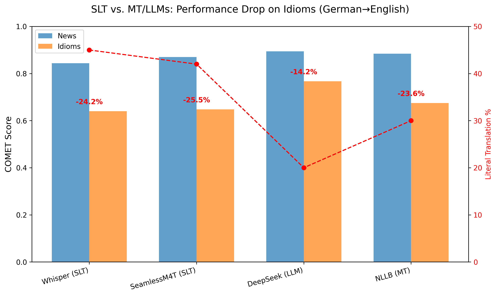
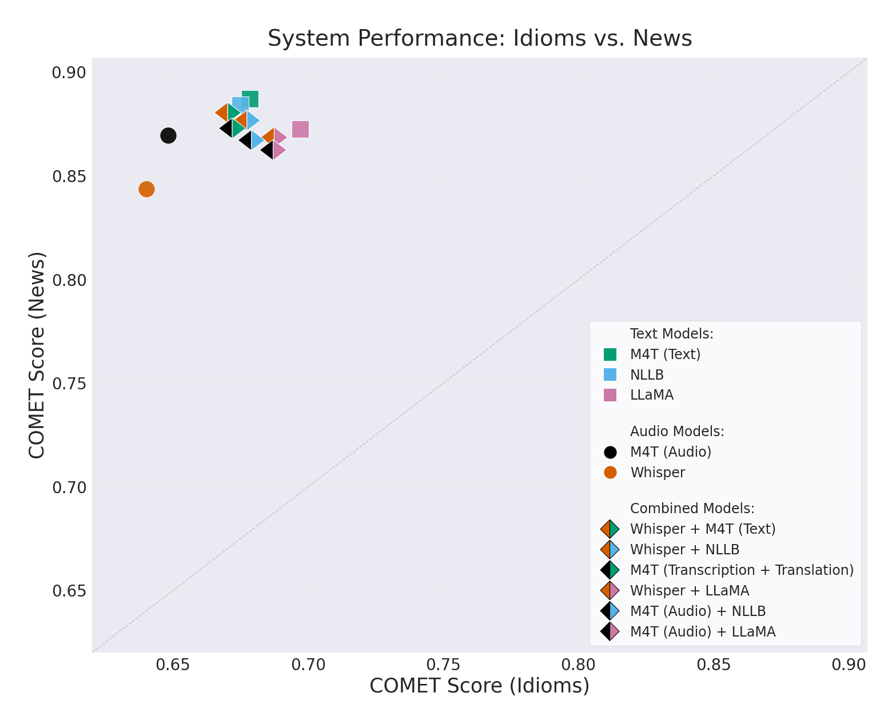
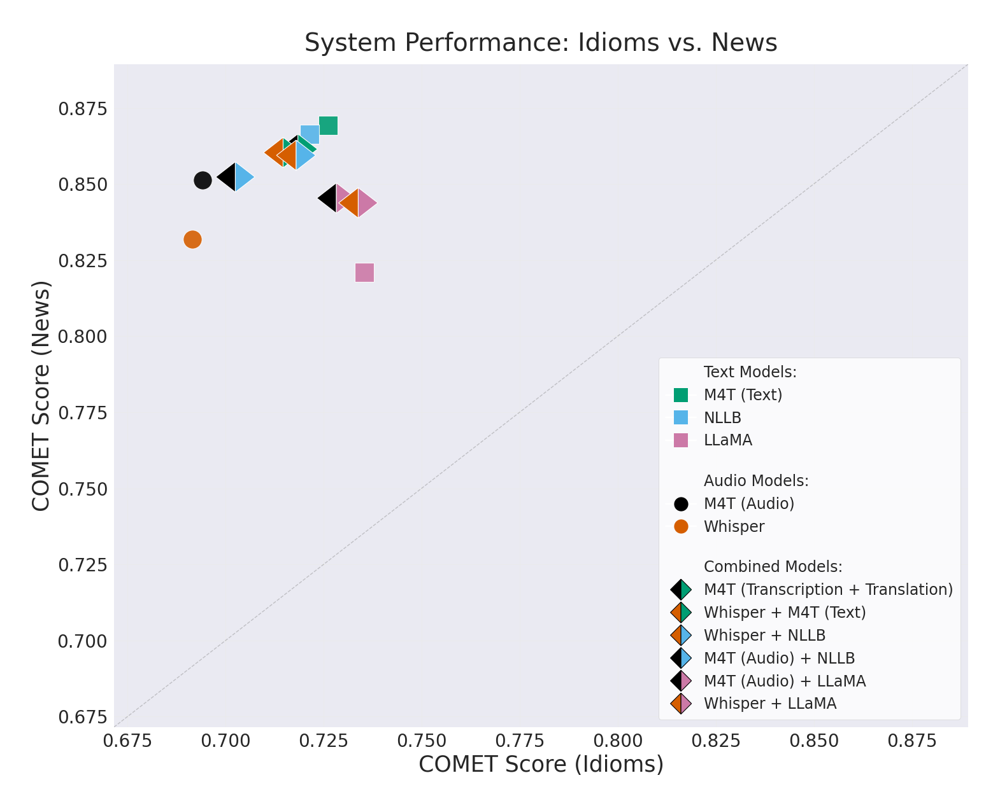

# It's Not a Walk in the Park! Challenges of Idiom Translation in Speech-to-text Systems

[ACL Anthology](https://aclanthology.org/2025.acl-long.1512/) · [arXiv](https://arxiv.org/abs/2506.02995) · ACL 2025, Vienna

Iuliia Zaitova, Badr M. Abdullah, Wei Xue, Dietrich Klakow, Bernd Möbius, and Tania Avgustinova.
Contact: [izaitova@lsv.uni-saarland.de](mailto:izaitova@lsv.uni-saarland.de)

Idioms are groups of words whose figurative meaning cannot be deduced from the individual words, and translating them is still a major weakness of machine translation, especially speech-to-text translation, where the literature is sparse. This repository accompanies the ACL 2025 paper that compares idiom translation with ordinary news translation for German to English and Russian to English, in both text-to-text machine translation and speech-to-text translation. The systems are end-to-end speech-to-text models (SeamlessM4T and Whisper Large v3), text machine translation (SeamlessM4T text-to-text and No Language Left Behind), large language models (DeepSeek-V3 and LLaMA 3), and cascaded systems that recognize speech and then translate the transcript. Speech-to-text systems show a pronounced drop on idiomatic data and often fall back to literal translations even in higher encoder layers, while machine translation systems and large language models handle idioms better. The paper argues for idiom-specific methods and stronger internal representations in speech-to-text models.



*German to English COMET for Whisper speech-to-text, SeamlessM4T speech-to-text, DeepSeek, and NLLB, with the literal-translation rate of idiom outputs on the right axis. This is the figure shipped in `plots/`. The literal-translation rates come from the manual annotation in the paper and are not stored as a table in this repository, so `scripts/make_plots.py` does not redraw this file.*




*System COMET on idioms (x) against news (y). Points below the diagonal score lower on idioms than on news. `scripts/make_plots.py` redraws both scatters from `comet_scores/`.*

## Repository structure

```
.
├── comet_scores/        # Segment- and system-level COMET workbooks
├── dataset/
│   ├── idioms/          # Idioms-InContext-MT text
│   └── news/news_commentary/   # 250-sentence News Commentary subsets
├── decoderlens/         # DecoderLens layer translations (TSV)
├── plots/               # Figures shipped with the paper
├── scripts/             # COMET and plotting code, plus inference placeholders
├── transcriptions/      # ASR transcripts (audio is not included)
├── translations/        # References and system hypotheses
├── LICENSE              # MIT, for the code in this repository
├── requirements.txt
└── README.md
```

`comet_scores/` has eight workbooks. For each of German to English and Russian to English, and for news and idioms, there is a segment file (`{pair}_{domain}_segment_scores.xlsx`, 250 rows) and a system file (`{pair}_{domain}_system_scores.xlsx`) with columns `System`, `COMET Score`, and `Std Dev`. Segment files interleave `{system}_score` and `{system}` columns. `Std Dev` is the population standard deviation of the segment scores.

`dataset/idioms/` holds Idioms-InContext-MT text (Stap et al., 2024). The 250-line `.dede` and `.ruru` files are the evaluation sources. The 1,000-line files are the upstream test sets and are not line-aligned with that subset. See the data card.

`dataset/news/news_commentary/` holds 250 aligned lines per side of News Commentary, one German–English subset and one English–Russian subset. The two subsets are not the same sentence segmentation.

`decoderlens/` holds three TSVs of intermediate-layer translations. The NLLB file covers all 250 German idiom sentences at encoder layers 0–24 (6,250 logical rows). For 249 of those sentences the source line is split before the closing quote, so the file is not strict TSV; the last sentence is stored as ordinary rows. The two SeamlessM4T text files are partial samples (one sentence each). Details are in the data card and in `scripts/decoderlens_analysis.py`.

`plots/` contains the three PNGs above: `slt_vs_mt_idioms_de_en.png`, `de_performance_comparison.png`, and `ru_performance_comparison.png`.

`transcriptions/` contains eight TSVs, one per language, domain, and recognizer (`whisper` or `m4t_audio`), with 250 rows. The header is `Audio File` and `Transcription`, except `transcriptions_{dede,ruru}_news_m4t_audio.tsv`, whose second column is labeled `Translation`. The text in those two files is still a German or Russian transcript, not an English translation. Direct speech-to-text translations are columns in `translations/`, not these TSVs.

`translations/` contains four workbooks, 250 rows each. `Original_text` and `Gold_translation` are the evaluation pair. Idiom files also have `Idiom` and `Gold_Idiom`. Remaining columns are system hypotheses. Column names mix `+` and `_` (`Whisper+NLLB`, `Whisper_M4T`); those spellings match `comet_scores/`.

`scripts/` is the code added so the release can be rerun. COMET scoring and plotting are implemented. Model inference and DecoderLens are placeholders with a `# TODO(author): paste original implementation` marker, because that code was not in the public snapshot. Each placeholder has `--check-existing`, which checks the released files and does not load a model.

## Data card

| Item | What is in the repository |
| --- | --- |
| Directions | German → English, Russian → English |
| Idiom source | [Idioms-InContext-MT](https://github.com/amazon-science/idioms-incontext-mt) (Stap et al., 2024). File headers: Copyright Amazon.com, Inc. or its affiliates, CC-BY-NC-4.0 |
| Idiom evaluation set | 250 German sentences (`idioms_in_context-test.dede-enus.dede`) and 250 Russian sentences (`idioms_in_context-test.ruru-enus.ruru`). The paper describes these as a manual selection, from the 1,000 test examples per pair, of idioms that need a non-literal translation |
| Idiom upstream files | 1,000 examples each, plus a four-line license header, in `idioms_in_context-test.dede-enus.enus`, `idioms_in_context-test.enus-dede.enus`, `idioms_in_context-test.enus-dede.dede`, and `idioms_in_context-test.ruru-enus.enus`. Not row-aligned with the 250-line sources |
| Idiom references used for scoring | `Gold_translation` (full sentence) and `Gold_Idiom` (idiom phrase) in the idiom translation workbooks |
| News source | 250-sentence subsets of [WMT News Commentary](https://data.statmt.org/news-commentary/): `News-Commentary.de-en_250.{de,en}` and `News-Commentary.en-ru_250.{en,ru}` |
| Audio | Not included. The paper synthesized speech with Microsoft Edge neural TTS and recognized 16 kHz audio. Transcript indexes use `.mp3` names: `dede_{0-249}.mp3`, `enus_dede_{0-249}.mp3`, `ruru_{0-249}.mp3`, `enus_ruru_{0-249}.mp3` |
| ASR transcripts | 8 TSVs × 250 rows. Header `Audio File`, `Transcription`, except the two news SeamlessM4T files, which label that column `Translation` while still holding a source-language transcript. Whisper transcripts often have a leading space |
| Hypotheses | 4 workbooks × 250 rows. Text systems: `NLLB`, `M4T_text`, `Llama`, `Deepseek`. Speech-to-text: `Whisper`, `M4T_audio`. Cascades: `Whisper+NLLB`, `Whisper_M4T`, `Whisper_Llama`, `Whisper+Deepseek`, `M4T_transcription+translation`, `M4T_NLLB`, `M4T_Llama`, `M4T+Deepseek` |
| COMET | `Unbabel/wmt22-comet-da`, as named in the paper. Released workbooks score every system above except the three DeepSeek columns. Idiom system files also score `Gold_Idiom` |
| Quirk in the Russian news scores | `translations_ru2en_news.xlsx` has an empty column header between `M4T_transcription+translation` and `Llama` (pandas reads it as `Unnamed: 11`). The released COMET files score a column named `Unnamed: 8`. `scripts/score_comet.py` skips blank headers |
| DecoderLens | NLLB, German idioms: 250 sentences × layers 0–24 (6,250 logical rows). 249 sentences are split across a newline inside quotes; the last sentence is 25 ordinary TSV rows. SeamlessM4T text: one German sentence (header says `Source Text (RU)`; some layers are repeated) and one Russian sentence in the `_ewae` file, whose name says `dede` |
| Human labels | The paper annotates 50 outputs per condition. Those labels are not a separate file here. They are what the right axis of `plots/slt_vs_mt_idioms_de_en.png` summarizes |

Models named in the paper: `openai/whisper-large-v3`, `facebook/seamless-m4t-v2-large`, `facebook/nllb-200-3.3B`, `VAGOsolutions/LLaMA-3-SauerkrautLM-8b-Instruct` (German), `IlyaGusev/saiga_LLaMA3_8b` (Russian), and DeepSeek-V3. The paper does not give a repository id for DeepSeek-V3. LLaMA and DeepSeek prompts are in Appendix A of the paper and are not copied here.

## Reproducing the results

Python 3.10 or newer. A GPU is needed for the model stages. COMET can run on CPU for a short smoke test. The commands below are what each stage is expected to run. Inference and DecoderLens stop at a marked TODO until the original implementation is pasted in. Their `--check-existing` mode is implemented and only reads the released files.

```bash
python -m venv .venv
source .venv/bin/activate
pip install -r requirements.txt
```

`requirements.txt` pins a set that installs with `unbabel-comet==2.2.7` (`numpy<2`, `transformers<5`, `huggingface-hub<1`). The PyPI torch wheel is large. For a CPU-only machine:

```bash
pip install torch==2.5.1 --index-url https://download.pytorch.org/whl/cpu
pip install -r requirements.txt
```

### Checks that run on the released files

These do not download Whisper, SeamlessM4T, NLLB, LLaMA, or the COMET checkpoint.

```bash
python scripts/run_s2t_inference.py --check-existing
python scripts/run_mt.py --check-existing
python scripts/decoderlens_analysis.py --check-existing
python scripts/score_comet.py --verify-released
python scripts/score_comet.py --dry-run --layout released
python scripts/make_plots.py --scores-dir comet_scores --output-dir plots/regenerated
```

`--verify-released` recomputes each system mean and population standard deviation from `comet_scores/*_segment_scores.xlsx` and compares them to `*_system_scores.xlsx`. `make_plots.py` writes new PNGs under `plots/regenerated/` and does not replace the paper figures.

### ASR and speech-to-text

Audio has to be synthesized first. The paper used Microsoft Edge neural TTS and 16 kHz mono input. Clips are not in this repository. The index names are listed in the data card.

```bash
python scripts/run_s2t_inference.py \
  --task asr \
  --model whisper \
  --language de \
  --domain idioms \
  --audio-dir /path/to/de-idiom-clips

python scripts/run_s2t_inference.py \
  --task s2t \
  --model seamless \
  --language ru \
  --domain news \
  --audio-dir /path/to/ru-news-clips
```

`--model whisper` is `openai/whisper-large-v3`. `--model seamless` is `facebook/seamless-m4t-v2-large`. ASR writes `transcriptions/transcriptions_{dede|ruru}_{news|idioms}_{whisper|m4t_audio}.tsv`. Speech-to-text hypotheses in the release are the `Whisper` and `M4T_audio` columns of the translation workbooks. The script raises `NotImplementedError` at the TODO until that code is pasted in.

### Machine translation and LLM baselines

```bash
python scripts/run_mt.py --system nllb --language de --domain idioms
python scripts/run_mt.py --system seamless-text --language ru --domain news
python scripts/run_mt.py --system llama --language de --domain idioms
python scripts/run_mt.py --system deepseek --language ru --domain idioms
python scripts/run_mt.py \
  --system cascade \
  --cascade-asr whisper \
  --cascade-mt nllb \
  --language de \
  --domain news
```

Text systems read the 250-line source files. Cascades read `transcriptions/`. Outputs are the hypothesis columns of `translations/translations_{de2en|ru2en}_{news|idioms}.xlsx`. This stage is a placeholder. Paste the original generation code and the Appendix A prompts at the TODO in `scripts/run_mt.py`.

### COMET

```bash
# Same system columns as the released workbooks. Writes comet_scores/rescored/.
python scripts/score_comet.py \
  --layout released \
  --model Unbabel/wmt22-comet-da \
  --output-dir comet_scores/rescored \
  --gpus 1 \
  --batch-size 8

# Also score Deepseek, M4T+Deepseek, and Whisper+Deepseek.
python scripts/score_comet.py --layout all --gpus 1 --output-dir comet_scores/rescored

# CPU smoke test on two segments of one pair.
python scripts/score_comet.py \
  --layout released \
  --pairs de2en \
  --domains idioms \
  --systems NLLB \
  --max-segments 2 \
  --gpus 0
```

The first run downloads `Unbabel/wmt22-comet-da`. The script refuses to overwrite the workbooks already in `comet_scores/` unless `--overwrite` is set. Segment files follow the released layout: `Original_text`, `Gold_translation`, optional `Idiom`, then `{system}_score` and `{system}`. System files use `System`, `COMET Score`, and `Std Dev`, with `Std Dev` computed at `ddof=0`.

### DecoderLens

```bash
python scripts/decoderlens_analysis.py \
  --model nllb \
  --language de \
  --domain idioms \
  --max-examples 50 \
  --output decoderlens/nllb_de_idioms.tsv
```

`--model` is one of `whisper`, `seamless-speech`, `seamless-text`, or `nllb`. The paper annotated 50 examples per condition. This stage is a placeholder. A pasted implementation should write strict TSV with one row per source sentence and encoder layer. Do not reuse the split-quote layout of `decoderlens/translations_dede_idioms_nllb_decoderlens.tsv`.

### Plots

```bash
python scripts/make_plots.py --scores-dir comet_scores --output-dir plots/regenerated
```

This writes `de_performance_comparison.png`, `ru_performance_comparison.png`, and `comet_news_vs_idioms.png`. The third file is a news-versus-idiom bar chart for the systems present in the score workbooks. It is not a replacement for `plots/slt_vs_mt_idioms_de_en.png`, which also shows DeepSeek and literal-translation rates.

## Code status

| Script | Status |
| --- | --- |
| `scripts/run_s2t_inference.py` | Placeholder. `--check-existing` validates the eight ASR TSVs |
| `scripts/run_mt.py` | Placeholder. `--check-existing` validates the four translation workbooks |
| `scripts/score_comet.py` | Implemented. Scores workbooks with `Unbabel/wmt22-comet-da`, and `--verify-released` checks the published system scores |
| `scripts/decoderlens_analysis.py` | Placeholder. `--check-existing` counts the released DecoderLens TSVs |
| `scripts/make_plots.py` | Implemented. Redraws the COMET scatters and a news-versus-idiom bar chart from `comet_scores/` |

## Licensing

The code in this repository is under the MIT License (see `LICENSE`). That license does not apply to the evaluation data. Idiom text from Idioms-InContext-MT carries an Amazon copyright header and is marked CC-BY-NC-4.0. The News Commentary subsets follow the terms of the WMT News Commentary corpus and the original publishers. Transcripts, translations, COMET scores, DecoderLens dumps, and figures are derived research outputs. Confirm that those files may be redistributed before reusing them outside this paper.

## Citation

Anthology record:

```bibtex
@inproceedings{zaitova-etal-2025-walk,
  title     = {It{'}s Not a Walk in the Park! Challenges of Idiom Translation in Speech-to-text Systems},
  author    = {Zaitova, Iuliia and Abdullah, Badr M. and Xue, Wei and Klakow, Dietrich and M{\"o}bius, Bernd and Avgustinova, Tania},
  editor    = {Che, Wanxiang and Nabende, Joyce and Shutova, Ekaterina and Pilehvar, Mohammad Taher},
  booktitle = {Proceedings of the 63rd Annual Meeting of the Association for Computational Linguistics (Volume 1: Long Papers)},
  month     = jul,
  year      = {2025},
  address   = {Vienna, Austria},
  publisher = {Association for Computational Linguistics},
  url       = {https://aclanthology.org/2025.acl-long.1512/},
  doi       = {10.18653/v1/2025.acl-long.1512},
  pages     = {31310--31322}
}
```

The citation key used in earlier versions of this README:

```bibtex
@inproceedings{zaitova2025idioms,
  title     = {It's Not a Walk in the Park! Challenges of Idiom Translation in Speech-to-text Systems},
  author    = {Iuliia Zaitova and Badr M. Abdullah and Wei Xue and Dietrich Klakow and Bernd M{\"o}bius and Tania Avgustinova},
  booktitle = {Proceedings of the 63rd Annual Meeting of the Association for Computational Linguistics (ACL)},
  year      = {2025}
}
```
